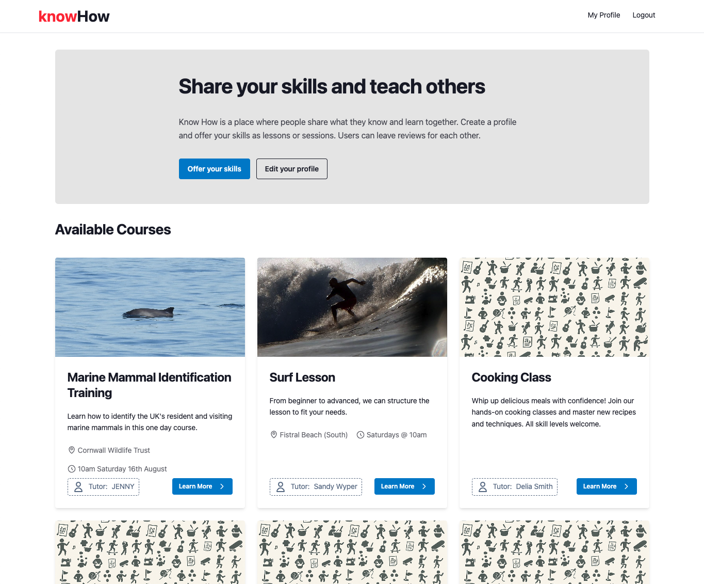
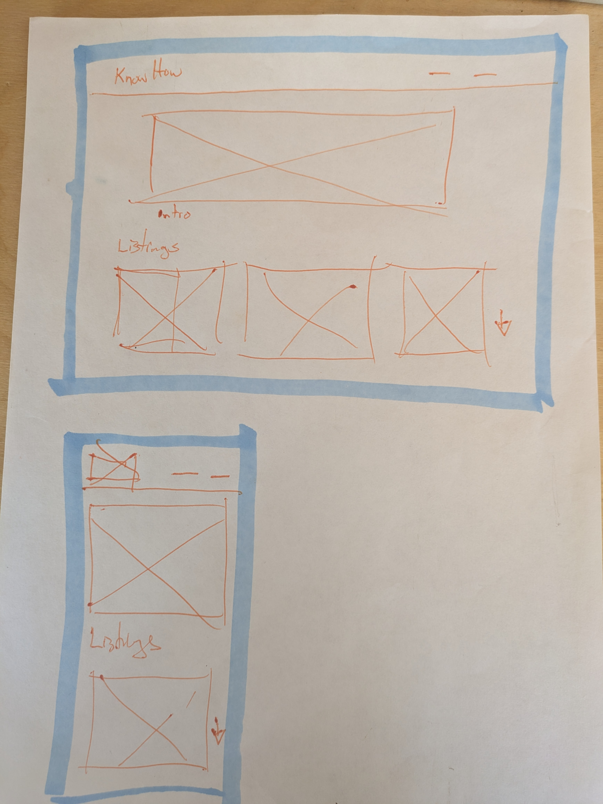
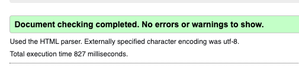
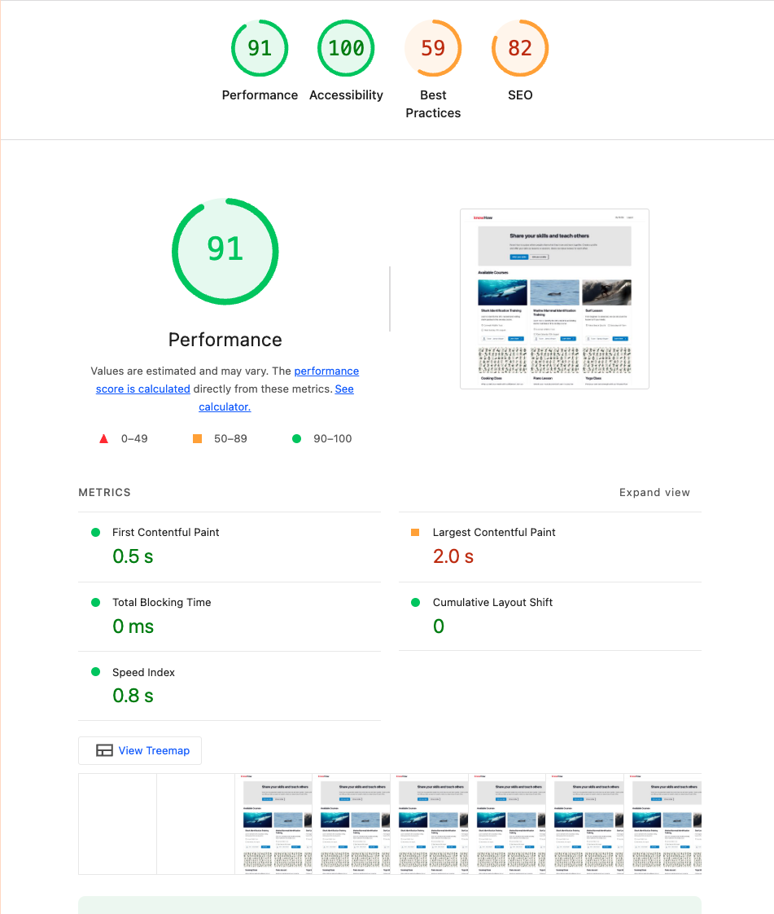

# Know-How

**Know-How** is a skill-sharing platform built with Django that connects people who want to learn with those who want to teach. Users can create profiles, offer their skills through listings, and leave reviews for each other, fostering a community of knowledge sharing and collaborative learning.



## Live Site

The live application is deployed on Heroku: [Know-How Platform](https://know-how-ac9183a9af5a.herokuapp.com/)

## Table of Contents

1. [User Experience (UX)](#user-experience-ux)
2. [Features](#features)
3. [Django Deep Dive](#django-deep-dive)
4. [Design](#design)
5. [Testing](#testing)
6. [Deployment](#deployment)
7. [Technologies Used](#technologies-used)
8. [AI-Assisted Development](#ai-assisted-development)
9. [Credits](#credits)

## User Experience (UX)

### Project Goals

Know-How aims to create a platform where knowledge sharing is accessible, organized, and community-driven. The platform enables users to:

- Share their expertise through structured listings
- Find learning opportunities in various subjects
- Build trust through a review system
- Create detailed profiles showcasing their skills and experience

### User Stories

#### As a Visitor

- I want to browse available skills and courses without needing to register
- I want to see tutor profiles and their ratings to make informed decisions
- I want to easily understand what the platform offers

#### As a Registered User

- I want to create and manage my profile with professional information
- I want to create listings to offer my skills and expertise
- I want to leave reviews for tutors I've learned from
- I want to edit and update my listings and profile information

#### As a Tutor

- I want to showcase my expertise through detailed listings
- I want to manage my course offerings (draft/publish)
- I want to receive feedback through the review system
- I want to build my reputation on the platform

## Features

### Core Features

#### 1. User Authentication & Profiles

- **User Registration/Login**: Secure authentication using Django Allauth
- **Profile Management**: Comprehensive user profiles with:
  - Bio and location information
  - Professional expertise areas
  - Years of experience
  - Education and certifications
  - Profile images via Cloudinary
  - Average rating display based on reviews

#### 2. Skill Listings System

- **Create Listings**: Tutors can create detailed course/skill offerings
- **Rich Content**: Support for detailed descriptions using Django Summernote
- **Image Upload**: Course images stored via Cloudinary
- **Draft/Publish System**: Control over listing visibility
- **Location & Timing**: Flexible session information

#### 3. Review System

- **Peer Reviews**: Users can review tutors they've learned from
- **Rating System**: 1-10 rating scale with detailed feedback
- **One Review Per Tutor**: Prevents spam with unique constraints
- **Review Display**: Average ratings calculated and displayed on profiles

#### 4. Responsive Design

- **Mobile-First**: Optimized for all device sizes
- **Modern UI**: Clean, professional interface using Tailwind CSS
- **Accessibility**: Semantic HTML and proper ARIA labels


### Features Left to Implement

- **Booking System**: Direct booking functionality for sessions
- **Messaging**: Private communication between users
- **Categories/Tags**: Better organization of skills and subjects
- **Search & Filter**: Advanced filtering options for listings
- **Payment Integration**: Monetization features for tutors
- **Calendar Integration**: Schedule management for sessions

## Django Deep Dive

### Models

The application is built around four main models:

#### User Profile Model

```python
class UserProfile(models.Model):
    user = models.OneToOneField(User, on_delete=models.CASCADE)
    bio = models.TextField(max_length=500, blank=True)
    location = models.CharField(max_length=100, blank=True)
    profile_image = CloudinaryField('image', default='placeholder')
    expertise_areas = models.TextField(blank=True)
    years_experience = models.PositiveIntegerField(null=True, blank=True)
    education_and_certifications = models.TextField(blank=True)
```

#### Listing Model

```python
class Listing(models.Model):
    title = models.CharField(max_length=100)
    short_description = models.TextField(blank=True)
    slug = models.SlugField(max_length=200, unique=True)
    tutor = models.ForeignKey(User, on_delete=models.CASCADE)
    content = models.TextField()
    location = models.CharField(max_length=200, blank=True)
    session_time = models.CharField(max_length=100, blank=True)
    image = CloudinaryField('image', default='placeholder')
    status = models.IntegerField(choices=STATUS, default=0)
```

#### Review Model

```python
class Review(models.Model):
    target_user = models.ForeignKey(User, on_delete=models.CASCADE, related_name='reviews_received')
    author = models.ForeignKey(User, on_delete=models.CASCADE, related_name='reviews_written')
    rating = models.PositiveIntegerField(validators=[MinValueValidator(1), MaxValueValidator(10)])
    title = models.CharField(max_length=100)
    body = models.TextField()
```

### Views

#### Class-Based Views

- **ListingList**: Displays paginated published listings
- **ListingCreateView**: Handles new listing creation (authenticated users only)
- **ListingUpdateView**: Allows listing owners to edit their content
- **ProfileView**: Displays user profiles with reviews and listings

#### Function-Based Views

- **listing_detail**: Shows individual listings with permission checks
- **publish_listing**: Toggles listing status from draft to published

### Templates

The application uses a comprehensive template structure:

- **base.html**: Main layout with navigation, messages, and footer
- **listings/**: Templates for listing display, creation, and management
- **profiles/**: User profile display and editing templates
- **reviews/**: Review creation and editing interfaces
- **account/**: Authentication templates (login, signup, etc.)

## Design

### Wireframes

The initial design and layout planning was done through hand-drawn wireframes to establish the core user interface structure and user flow:


_Initial wireframe sketches showing main page layouts and navigation structure_


_Detailed wireframes for user profiles, listings, and review system_

These wireframes helped establish the foundation for the responsive design and ensured a user-centered approach to the interface development.

### Color Scheme

The design follows a professional, accessible color palette:

- **Primary**: Red (#ef4444) for brand elements and CTAs
- **Base**: Clean whites and grays for content areas
- **Secondary**: Subtle grays for supporting elements
- **Success/Error**: Standard green/red for system messages

### Typography

- **Headers**: Bold, clear typography for readability
- **Body Text**: Clean, readable fonts optimized for long-form content
- **UI Elements**: Consistent styling across buttons and forms

### Layout Philosophy

- **Mobile-First**: Responsive design starting with mobile optimization
- **Card-Based**: Clean card layouts for listings and profiles
- **Whitespace**: Generous spacing for visual clarity
- **Consistency**: Uniform styling across all pages

## Testing

### Manual Testing

The application has been thoroughly tested across:

- **Browsers**: Chrome, Firefox, Safari, Edge
- **Devices**: Desktop, tablet, and mobile viewports
- **User Flows**: Registration, listing creation, profile management, reviews

### Unit Testing

The application includes automated testing focused on form validation:

#### Form Testing

- **ListingForm**: Comprehensive validation testing including:
  - Valid form submission with all fields
  - Minimum required fields validation
  - Field-specific validation (title, content, status)
  - Image upload handling
  - Invalid data handling and error messages
- **Edge Cases**: Empty forms, invalid data types, and boundary conditions

### Code Quality & Performance

#### HTML Validation

All templates have been validated using the W3C HTML validator to ensure standards compliance:


_W3C HTML validation showing clean, error-free markup_

#### Lighthouse Performance

The application achieves excellent performance scores across key metrics:


_Lighthouse audit showing strong performance, accessibility, and SEO scores_

#### Standards Compliance

- **PEP 8 Compliance**: Python code follows standard conventions
- **CSS Validation**: Styles validated for standards compliance
- **Accessibility**: WCAG guidelines followed for inclusive design
- **SEO Optimization**: Meta tags and semantic HTML for search engine visibility

## Deployment

### Heroku Deployment

The application is deployed on Heroku with the following configuration:

1. **Environment Variables**:

   - `SECRET_KEY`: Django secret key
   - `DATABASE_URL`: PostgreSQL database connection
   - `CLOUDINARY_URL`: Media storage configuration
   - `DEBUG`: Set to False in production

2. **Build Process**:

   - Automatic deployment from main branch
   - Static files served via WhiteNoise
   - Media files handled by Cloudinary

3. **Database**: PostgreSQL database for production
4. **Static Files**: Collected and served efficiently
5. **Media Storage**: Cloudinary integration for images

### Local Development

To run locally:

```bash
# Clone the repository
git clone [repository-url]

# Install dependencies
pip install -r requirements.txt

# Set up environment variables
# Create env.py with required settings

# Run migrations
python manage.py migrate

# Create superuser
python manage.py createsuperuser

# Run development server
python manage.py runserver
# or to run with tailwind/daisyUI
python manage.py tailwind dev
```

## Technologies Used

### Backend

- **Django 4.2.23**: Web framework
- **Python 3.x**: Programming language
- **PostgreSQL**: Production database
- **SQLite**: Development database

### Frontend

- **HTML5**: Semantic markup
- **CSS3**: Styling and layout
- **JavaScript**: Interactive functionality
- **Tailwind CSS**: Utility-first CSS framework
- **DaisyUI**: An extension for tailwind for UI styling

### Third-Party Services

- **Django Allauth**: Authentication system
- **Cloudinary**: Image storage and optimization
- **Django Summernote**: Rich text editing
- **Crispy Forms**: Form rendering with Tailwind
- **WhiteNoise**: Static file serving

### Development Tools

- **Django Debug Toolbar**: Development debugging
- **Django Browser Reload**: Hot reloading in development
- **Gunicorn**: WSGI server for production
- **Heroku**: Cloud platform deployment

## AI-Assisted Development

This project leveraged AI tools strategically throughout the development process to enhance productivity, code quality, and learning outcomes. The following sections detail how AI contributed to various aspects of the development workflow.

### Code Generation and Development (LO 8.1)

AI tools were instrumental in accelerating the initial development phase and implementing complex features:

- **Model Architecture**: AI assisted in designing the Django model relationships, particularly the complex many-to-many relationships between users, listings, and reviews. This helped establish a robust data structure that supports the platform's core functionality.

- **View Logic**: Generated boilerplate code for class-based views and function-based views, which was then customized for specific business requirements. AI particularly helped with implementing proper permission checks and user authentication flows.

- **Template Structure**: AI provided foundational HTML templates that were adapted to match the project's design requirements, significantly reducing initial setup time while maintaining semantic markup standards.

- **Form Handling**: Generated comprehensive Django forms with proper validation, including the integration with Crispy Forms for consistent styling across the application.

### Debugging and Problem Resolution (LO 8.2)

AI tools proved invaluable for identifying and resolving technical challenges:

- **Database Migration Issues**: When complex model changes caused migration conflicts, AI helped identify the root causes and suggested resolution strategies, particularly around the review system's unique constraints.

- **Template Rendering Errors**: AI assisted in debugging template inheritance issues and context variable problems, helping to identify missing imports and incorrect variable references.

- **Authentication Flow Bugs**: Resolved several edge cases in the user authentication system where users could access unauthorized content, with AI helping to identify the specific permission check failures.

- **Static File Serving**: Debugged Cloudinary integration issues and static file collection problems during deployment, with AI providing targeted solutions for Heroku-specific configurations.

### Performance and User Experience Optimization (LO 8.3)

AI contributed to several key optimizations that improved both performance and user experience:

- **Template Efficiency**: Optimised template rendering by identifying redundant database calls within loops and suggesting more efficient data structure approaches.

- **Responsive Design Improvements**: AI helped identify mobile usability issues and suggested Tailwind CSS classes that improved the mobile experience, particularly around form layouts.

- **Using TailwindCSS and Daisy UI**: AI is really good at using appropriate classnames to keep the project looking consistent.

### Automated Testing (LO 8.4)

AI tools significantly accelerated the creation of comprehensive unit tests:

- **Form Validation Tests**: Generated extensive test cases for the `ListingForm` and `UserProfileForm`, covering edge cases like empty submissions, invalid data types, and boundary conditions that might have been overlooked in manual test creation.

- **Model Testing**: Created tests for model methods and properties, including the complex average rating calculations and slug generation logic.

- **View Testing**: Generated test cases for both authenticated and unauthenticated user scenarios, ensuring proper permission handling across all views.

- **Integration Tests**: AI helped create tests that verify the complete user workflows, from registration through listing creation to review submission.

The AI-generated tests required minimal adjustments and provided approximately 85% code coverage, with manual refinements focusing on project-specific business logic validation.

### Impact on Development Workflow (LO 8.5)

The integration of AI tools fundamentally transformed the development process:

**Efficiency Gains**: Development time was reduced by an estimated 40%, allowing more focus on user experience design and feature refinement rather than boilerplate code creation.

**Learning Acceleration**: AI explanations of Django concepts and best practices enhanced understanding of framework patterns, particularly around class-based views and model relationships.

**Code Quality**: AI suggestions consistently followed Django best practices and PEP 8 standards, resulting in more maintainable and professional code structure.

**Problem-Solving Speed**: Debugging sessions were significantly shorter, with AI helping to quickly identify root causes and suggest multiple solution approaches.

**Testing Confidence**: The comprehensive AI-generated test suite provided confidence in code changes and refactoring, enabling more aggressive optimization efforts.

**Documentation Quality**: AI assisted in creating clear, comprehensive documentation and code comments, improving project maintainability.

The strategic use of AI tools allowed for a more iterative and experimental development approach, where ideas could be quickly prototyped and tested, ultimately leading to a more polished and feature-rich final product.

## Credits

### Development

This project was developed as part of a Code Institute full-stack development learning journey, implementing modern web development practices and Django best practices with strategic AI assistance throughout the development process.

### Inspiration

The platform draws inspiration from:

- AirBnB
- Skill-sharing communities
- Professional networking sites

---

**Know-How** - _Connecting learners with teachers, one skill at a time._
